<div align="center">
  <table>
    <tr>
      <td align="center" width="120">
        
      </td>
      <td>
        <h1>NoteLM</h1>
        <p>
          AI-powered study assistant that uses RAG to turn your sources into interactive learning experiences with source-grounded answers.
        </p>
      </td>
    </tr>
  </table>
</div>

---
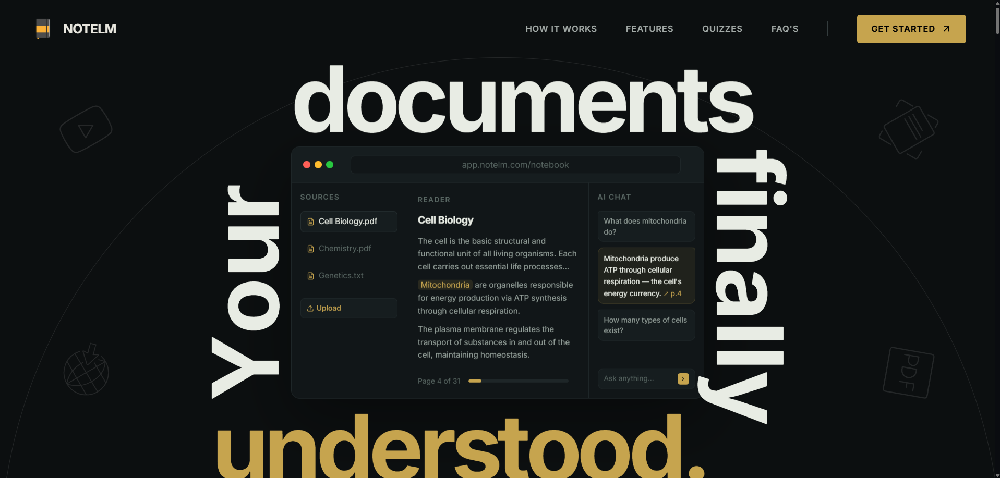

---
<p align="center">
  <a href="https://mynotelm.vercel.app/"><strong>🌐 View Live Demo →</strong></a>
  <br/>
  <sub>Note: The live demo currently showcases the frontend only. Backend functionality requires a locally configured backend server.</sub>
</p>


## Table of Contents

- [About](#About)
- [Core Features](#core-features)
- [Tech Stack](#tech-stack)
- [Folder Structure](#folder-structure)
- [Setup & Installation](#setup--installation)
  - [Prerequisites](#prerequisites)
  - [Frontend](#frontend)
  - [Backend](#backend)
- [Key Workflows & Implementation Details](#key-workflows--implementation-details)
- [Future Improvements](#future-improvements)
- [Contact](#contact)
- [Screenshots](#screenshots)

## About
NoteLM is an AI-powered learning and research assistant designed to make studying more interactive, organized, and efficient. It allows users to bring together information from multiple sources, including **PDF documents**, **websites URLs**, **YouTube videos**, and **custom text**, and interact with that content through AI-powered conversations. 

Using Retrieval-Augmented Generation (RAG), NoteLM provides context-aware answers grounded in uploaded materials, helping users understand complex topics while maintaining references to the original sources. Beyond question answering, it offers tools to generate quizzes, flashcards, study roadmaps, mind maps, and assignment solutions from learning materials.

I built this to have a personalized, collaborative learning into a single workspace & study assistant that actually understands my course materials without relying entirely on generic AI responses, giving learners a more personalized and engaging way to study.

## Core Features

- ### 📃 Document Processing:
   - Upload PDFs, DOCX, TXT, or images. The app extracts text (using tools like pdf-parse, mammoth, and tesseract) and chunks it for processing.
- ### 💬 RAG-based Chat:
   - Ask questions about your documents. The backend uses a local vector store (Vectra) and Ollama/Mistral to retrieve relevant chunks and generate accurate, context-aware answers.
- ### 🧠 Smart Quizzes:
   -  Generate MCQs, true/false, and short-answer questions from your notes. 
- ### ❔ Live Multiplayer Quizzes:
   - Host Kahoot-style live sessions where participants can join via a code, answer in real-time, and compete on a leaderboard (powered by Socket.io).
- ### 📝 Notebooks:
   - Group different sources (PDFs, URLs, YouTube transcripts, raw text) into a single workspace and chat with the combined knowledge base.
- ### 📊 Analytics Dashboard:
   - Track your learning streaks, average scores, and recent activities with dynamic charts (Recharts).


## Tech Stack

**Frontend**
- React (Vite)
- Zustand (State Management)
- Tailwind CSS
- Axios
- See [Frontend Tech Stack](frontend/README.md#tech-stack) for more details.

**Backend**
- Node.js & Express
- MongoDB (Mongoose)
- See [Backend Tech Stack](backend/README.md#tech-stack) for more details.

## Folder Structure

```text
├── backend
│   ├── ...
│   └── README.md
│
├── frontend
│   ├── ...
│   └── README.md
│
├── .gitignore
└── README.md
```

## Setup & Installation

### Prerequisites
- Node.js (v18 or later)
- MongoDB (local instance or MongoDB Atlas URI)
- Ollama (optional, for running local embedding and language models)

### Frontend
See the [Frontend Setup Guide](frontend/README.md).

### Backend
See the [Backend Setup Guide](backend/README.md).

## Key Workflows & Implementation Details

- **Vector Search & RAG:** Uploaded documents are split into smaller chunks and converted into embeddings using Ollama's embedding models. These vectors are stored locally using Vectra. During conversations, the user's query is embedded, relevant chunks are retrieved through similarity search, and the retrieved context is passed to the LLM to generate source-grounded responses.

- **Real-Time Quizzes:** A host creates a quiz session and generates a unique access code. Participants join through Socket.IO rooms, while the host controls the quiz flow, including starting the quiz and moving between questions. The server evaluates answers and calculates scores based on correctness and response time.

- **LLM Integration & Fallbacks:** NoteLM supports local inference through Ollama and cloud-based generation through Mistral AI (`MyAiServer.js`), allowing users to switch between local and online AI services.

## Future Improvements

- Support additional embedding models and cloud-based vector databases such as Pinecone.
- Introduce background job processing using Redis and BullMQ for handling large document uploads without blocking HTTP requests.
- Improve mobile responsiveness, particularly for the live quiz participant interface.
- Add more detailed feedback on document processing and vector indexing progress.

<!-- ## 📬 Contact -->
## Contact

- 😺 GitHub: https://github.com/prasad-pranay  
- 📧 Email: prasadpranay2005@gmail.com
- 🫠 Portfolio: https://pranay-resume.vercel.app
- ⚽ Instagram: [pranayy.c3](https://www.instagram.com/pranayy.c3/)

## Screenshots
|Landing Page|Home Page|
|---|---|
||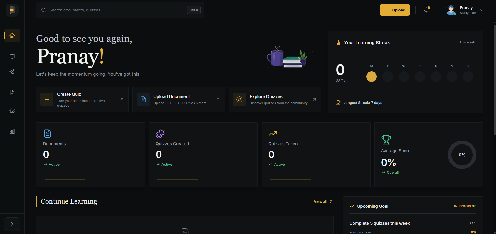|

|Your Workspace|Ask Question from Sources|
|---|---|
|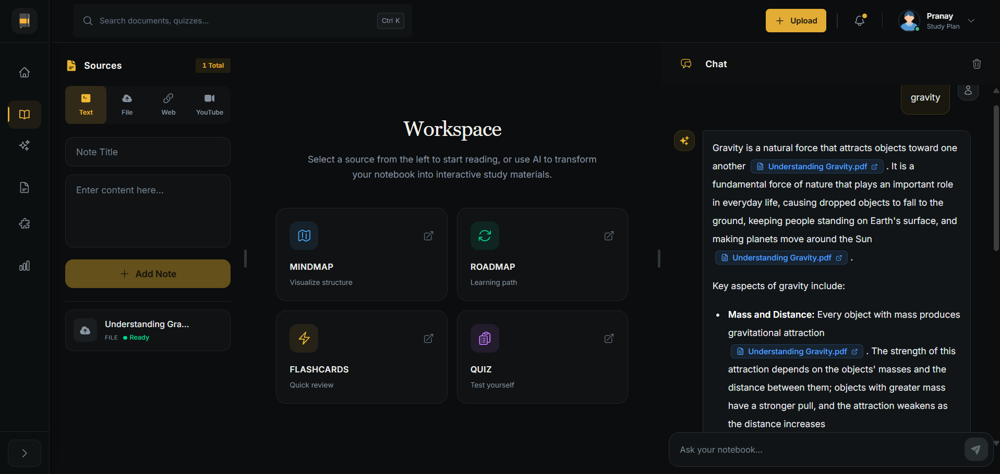|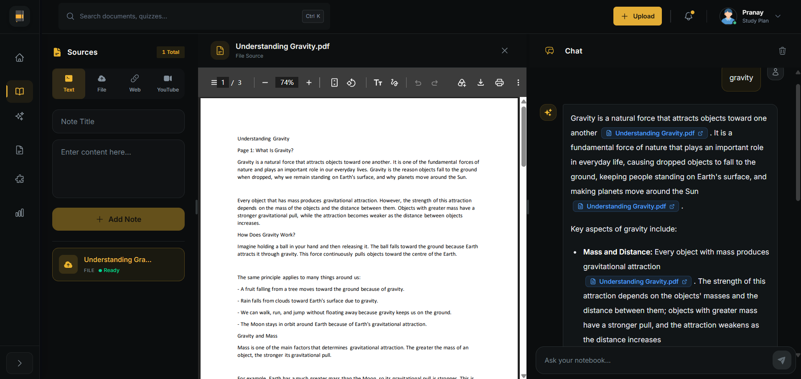|

|Your Storage|Quizzes (Create + Host)|
|---|---|
|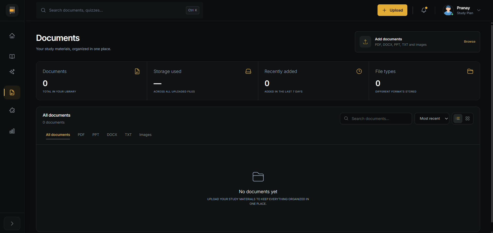|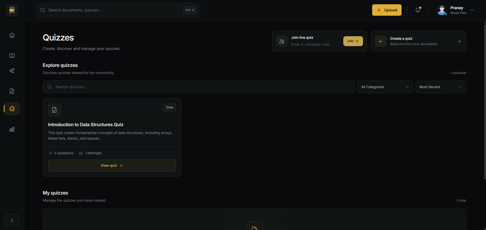|

|Quiz Page|Analytics|
|---|---|
|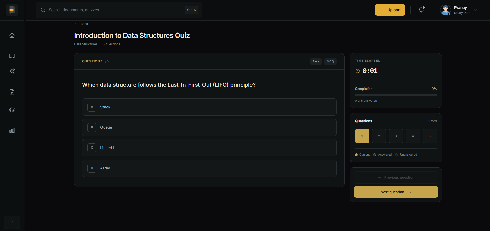|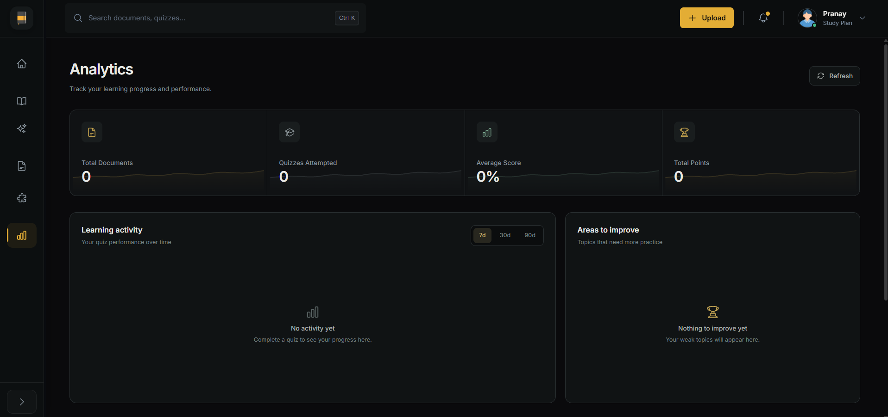|

|Answer Generator|Download answers PDF|
|---|---|
|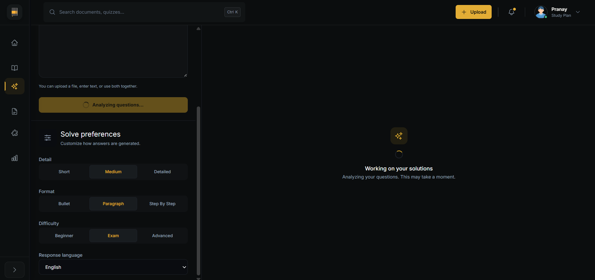|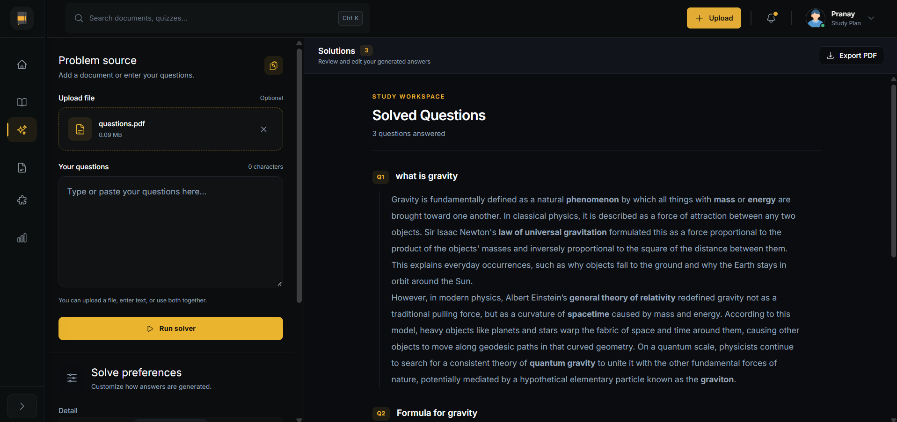|


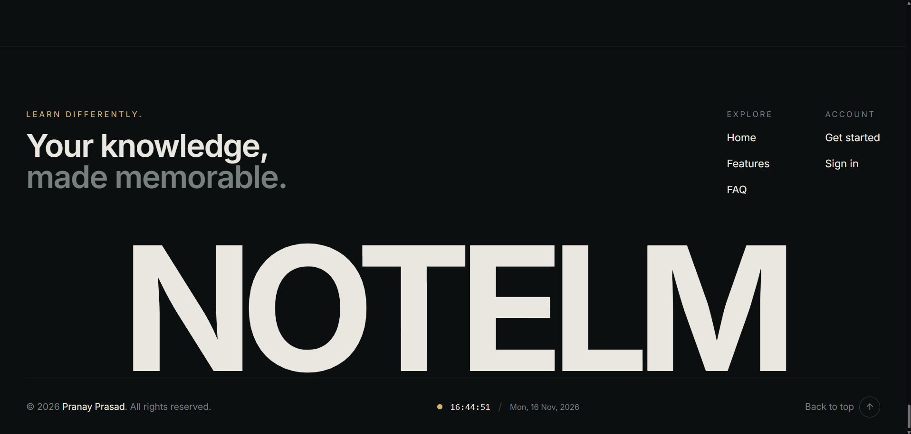


